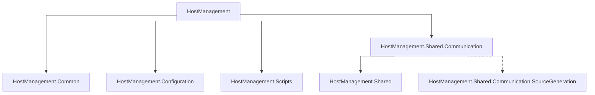

# HostManagement

Das Projekt **HostManagement (HM)** ist eine AOT kompilierte .NET-Anwendung für Debian. Es dient der Bereitstellung einer einheitlichen Schnittstelle zur Systemkonfiguration und ermöglicht die Kommunikation mit übergeordneten Anwendungen (z. B. **ViciOne Suite**) über Named Pipes.

| | | |
| :- | :- | :- |
| **[Hauptziele des Projektes](#hauptziele-des-projektes)** <br> Übersicht / Ziele | **[Projektstruktur](#projektstruktur)** <br> Hauptkomponenten / Projektstruktur | **[Deployment](#deployment)** <br> Toolchain installieren / Veröffentlichung |
| **[Installation](#installation)** <br> Abhängigkeiten / Installation Debian-Paket | **[Benutzung](#benutzung)** <br> Service / Kommandozeile / Umgebungsvariablen / Logging / GitHub Copilot | |

## Hauptziele des Projektes

* Bereitstellung einer einheitlichen Schnittstelle zur Systemkonfiguration für Linux und Docker/Kubernetes.
* Implementierung permanenter, konfigurierbarer Health-Checks des Systems und der übergeordneten Anwendung.
* Effiziente Kommunikation mit der übergeordneten Anwendung über Named Pipes. Das **HostManagement** ist der Server, die **ViciOne Suite** ist der Client.
* Auf Flash Systemen sollen alle Elemente die häufig schreiben im RAM oder einer RAM-Disk liegen.
* Minimalistisches Design und hohe Effizienz, um die Größe des Tools und der zugehörigen Bibliotheken zu minimieren.
* Bereitstellung als AOT-kompilierte Command-Line-Anwendung.
* Bereitstellung umfassender Validierungen für Benutzereingaben und Systemkonfigurationen, um Fehler zu minimieren und die Zuverlässigkeit zu gewährleisten.
* Unterstützung mehrerer Sprachen für die Validierungen der UI.
* Da das **HostManagement** erhöhte Rechte besitzt ist sicherzustellen, dass nur die zugehörige übergeordnete Anwendung oder ein Shellscript mit gleichen oder höheren Rechten Zugriff auf das **HostManagement** hat.

Eine Beschreibung der konzeptionellen Ideen und Designentscheidungen findet sich unter: [Konzept]

## Projektstruktur

Das Projekt ist in mehrere Hauptkomponenten unterteilt:



<details>
  <summary markdown="span">

  `Details Projektstruktur`

  </summary>

  ```text
  HostManagement                           <-- HostManagement Solution
  ├── HostManagement                       <-- Hauptprojekt für das Host Management (HM)
  │   ├── Communication                    <-- Hier werden alle Kommunikationskanäle definiert
  │   │   ├── CommandLine                  <-- CLI-Implementierung (Kommunikation über Named Pipes)
  │   │   │   ├── Commands                 <-- Commands der CLI
  │   │   │   ├── Output                   <-- Output-Formatierung für die CLI
  │   │   │   └── Validators               <-- Validatoren für die CLI
  │   │   └── NamedPipes                   <-- Named Pipes Implementierung (zur Kommunikation mit der ViciOne Suite)
  │   │       ├── Client                   <-- Client-Implementierung
  │   │       └── RequestHandlers          <-- Request Handler für die Named Pipes (zum Laden/Anwenden von Settings etc.)
  │   ├── Services                         <-- Services für DHCP, Netzwerkstatus-Informationen, NTP, physikalische Adressen, System und systemd units
  │   ├── SystemConfig                     <-- Klassen zur Modifikation der Konfiguration des Systems
  │   │   ├── Network                      <-- Netzwerk-Konfigurationsadapter
  │   │   └── Service                      <-- Service-Konfigurationsadapter
  │   ├── ViciOneSuite                     <-- ViciOne Suite spezifische Funktionen (Version, Installation)
  │   │
  │   └── Program.cs                       <-- Einstiegspunkt des Tools
  │
  │
  ├── HostManagement.Common                <-- Unterprojekt für Helper, Utilities, Abstractions etc.
  │   ├── Utilities                        <-- Utility-Klassen
  │   └── Wrappers                         <-- Wrapper für System-Funktionen
  │
  │
  ├── HostManagement.Configuration         <-- Unterprojekt für Anwendungs-Konfigurationen (Umgebungsvariablen, anwendungsspezifische Pfade etc.)
  │
  │
  ├── HostManagement.Scripts               <-- Unterprojekt für die Scripts, die mit dem Basissystem kommunizieren
  │   ├── Enums                            <-- Sammelordner für Enums
  │   ├── Extensions                       <-- Extensions (z. B. für string-Anpassungen bzgl. Unix-LineEndings)
  │   ├── Resources                        <-- Alle deploybaren Ressourcen (Scripte etc.)
  │   │   └── Scripts                      <-- Shell-Scripte - alle Scripte zur Kommunikation mit dem Basissystem
  │   │       ├── shared
  │   │       │   ├── Common               <-- Scripte zur allgemeinen Verwendung
  │   │       │   ├── System               <-- Scripte für System-Operationen
  │   │       │   └── SystemdUnit          <-- Scripte zum steuern von systemd units
  │   │       └── targets
  │   │           ├── debian
  │   │           │   ├── Common           <-- Symlink zu Scripten aus shared
  │   │           │   ├── System           <-- Debian-spezifische System-Scripte
  │   │           │   └── SystemdUnit      <-- Symlink zu Scripten aus shared
  │   │           └── edges-vicione
  │   │               ├── Common           <-- Symlink zu Scripten aus shared
  │   │               ├── Network          <-- Untergruppe für Netzwerkscripte
  │   │               ├── System           <-- EdgeS ViciOne-spezifische System-Scripte
  │   │               ├── SystemdUnit      <-- Symlink zu Scripten aus shared
  │   │               └── ViciOne          <-- ViciOne-spezifische Scripte
  │   │
  │   ├── ResourceManager.cs               <-- Verantwortlich für Deployment/Aufrufbarkeit der Scripte
  │   ├── ScriptOptionNames.cs             <-- Alle Namen der Optionen für die jeweiligen Scripte (z. B.: "--ip-address")
  │   ├── ScriptResponse.cs                <-- Die Script-Antwort inkl. ExitCode und Warnungen/Fehlern
  │   └── ScriptRunner.cs                  <-- Führt alle Scripte aus
  │
  │
  ├── HostManagement.Shared                <-- Unterprojekt für die Komponenten, die im HostManagement und in der ViciOne Suite genutzt werden
  │   ├── Contracts                        <-- Datenmodell der Systemkonfiguration
  │   ├── Serialization                    <-- Serialisierungs-Logik
  │   └── Validation                       <-- Validierung der Systemkonfiguration
  │       └── Validators                   <-- Ordner für Validierungsklassen
  │
  │
  ├── HostManagement.Shared.Communication  <-- Unterprojekt für Named Pipe Kommunikation zwischen HostManagement und ViciOne Suite
  │   ├── Contracts                        <-- Datenmodell für die Kommunikation
  │   └── Serialization                    <-- Serialisierungs-Logik
  │
  │
  └── HostManagement.Shared.Communication.SourceGeneration  <-- Source Generator für die Kommunikation
  ```

</details>

### HostManagement

Dies ist das Hauptprojekt des Tools und enthält die **Kernlogik** für die **Systemkonfiguration**.

Es umfasst die Definitionen der Befehle für die **Kommandozeile** und die Logik für die Kommunikation über **Named Pipes**.

### HostManagement.Common

`HostManagement.Common` enthält **gemeinsame Logik** innerhalb des **HostManagement** (Helper, Utilities, Abstractions etc.).

### HostManagement.Configuration

`HostManagement.Configuration` enthält Anwendungs-Konfigurationen wie **Umgebungsvariablen** oder **anwendungsspezifische Pfade**.

### HostManagement.Scripts

Dieser Teil der Anwendung ist für die Ausführung der **Shell-Skripte** verantwortlich und kann angepasst werden, falls eine neue Unix-Plattform unterstützt werden soll.

`HostManagement.Scripts` ist die einzige **Schnittstelle** zum **Betriebssystem** und führt alle Lese- und Schreiboperationen der Systemkonfiguration durch. Es dient auch als Datenquelle für das **Monitoring** und die **Health-Checks**.

Wird ein **Shell-Skript** ausgeführt, gibt dieses eine Antwort ([ScriptResponse]) zurück, welche angibt, ob die durchgeführten Aktionen erfolgreich waren und ob Warnungen oder Fehler aufgetreten sind.

### HostManagement.Shared

`HostManagement.Shared` enthält eine gemeinsame **Bibliothek** für alle **Validierungen** (z. B.: [DNS Validation]) und das **Datenmodell** der **Systemkonfiguration**. Diese Bibliothek wird sowohl vom **HostManagement** als auch von der **ViciOne Suite** verwendet.

### HostManagement.Shared.Communication

`HostManagement.Shared.Communication` enthält eine gemeinsame **Bibliothek** für die **Kommunikation** über **Named Pipes**. Diese Bibliothek wird sowohl vom **HostManagement** als auch von der **ViciOne Suite** verwendet.

## Deployment

### Installieren der Toolchain

Eine Anleitung zum Installieren der Toolchain, z. B. in VMWare, siehe [hier](/docs/InstallToolchain.md).

### Veröffentlichen

* Für Linux x64

    ```bash
    dotnet publish -r linux-x64
    ```

* Für Linux ARM 64

    ```bash
    dotnet publish -r linux-arm64
    ```

**Hinweis:** AOT-Kompilierung ist für `dotnet publish` konfiguriert. `dotnet build` ignoriert die AOT-Einstellung.

## Installation

Das HostManagement unterstützt die folgenden Umgebungen:

* EdgeS ViciOne
* Debian (aktuell ist der Funktionsumfang eingeschränkt auf die Verwaltung von systemd units)

Die Abhängigkeiten unterscheiden sich je Umgebung, die Einrichtung und Benutzung ist jedoch auf allen Umgebungen gleich.

### Abhängigkeiten

**Hinweis:** Nicht aufgelistet sind core, text/shell und system utils, die in jeder Linux Distribution vorhanden sind.

#### EdgeS ViciOne

* `netplan` (alle Netzwerkmanager außer `systemd-networkd` müssen deaktiviert sein; Lizenziert unter GPL-3.0)
* `wget` (Lizenziert unter GPL-3.0)
* `fw_printenv` (internes tool ohne Lizenz)
* `systemd`
  * `systemd-networkd` enabled
  * `systemd-resolved` enabled (DNS Namensauflösung inkl. Diensterkennung in lokalen Netzwerken über mDNS)

#### Debian

* `wget` (Lizenziert unter GPL-3.0)

### Einrichtung

* Download der aktuellen Version aus [GitLab][GitlabHostManagementPackage] -> Pipelines -> Stage `Packaging`
* Installation des Debian-Paketes mit `sudo apt install ./<PackageName>`

## Benutzung

> **Hinweis:** Das `HostManagement` benötigt erweiterte Rechte, um Einstellungen am System vornehmen zu können (z. B.: Ändern der Netzwerkeinstellungen).

1. Ausführung des `HostManagement` im **daemon mode**, zum Beispiel als Linux-Service

    `hostmanagement --daemon`

1. Ausführung des `HostManagement` als **CLI**-Anwendung, welche mit dem zuvor über Named Pipes gestarteten Dienst kommuniziert

    `hostmanagement [command] [options]`

    **Beispiel "HTTP-Proxy":**

    ```bash
    hostmanagement network proxy http -e <true/false> -s <server> -p <port> -u <username> -pw <password>
    hostmanagement network proxy http --enabled <true/false> --server <server> --port <port> --username <username> --password <password>
    ```

### Umgebungsvariablen

Eine Auflistung der Umgebungsvariablen welche für das HostManagement definiert sind, befindet sich [hier](/docs/EnvironmentVariables.md).

### Log Level

Das HostManagement gibt standardmäßig Log-Meldungen ab Log-Level `Warning` aus. Das Log-Level kann über die Umgebungsvariable `LOGGING__LOGLEVEL__DEFAULT` angepasst werden. Mögliche Log-Level sind die Log-Level des Enums `Microsoft.Extensions.Logging.LogLevel`.

Beispiel **Service**:

```bash
LOGGING__LOGLEVEL__DEFAULT=Information sudo -E hostmanagement --daemon
```

Beispiel **Client**:

```bash
LOGGING__LOGLEVEL__DEFAULT=Information sudo -E hostmanagement network list-interfaces
```

### GitHub Copilot

Das Projekt nutzt benutzerdefinierte GitHub Copilot Anweisungen ([`copilot-instructions.md`]) sowie Anweisungen für die Arbeit mit Unit-Tests ([`testing.instructions.md`]).

Benutzerdefinierte lokale Anweisungen können in `.github/instructions/user-defined.instructions.md` hinterlegt werden. Diese Datei ist in der [`.gitignore`] ausgenommen und wird nicht mit eingecheckt.

[`copilot-instructions.md`]: .github/copilot-instructions.md
[DNS Validation]: docs/DNSValidation.md
[`.gitignore`]: .gitignore
[GitlabHostManagementPackage]: https://gitlab.i40.ifm-datalink.net/acx/vo-suite/hostmanagement-deb-packaging
[Konzept]: docs/Concept.md
[ScriptResponse]: docs/ScriptResponse.md
[`testing.instructions.md`]: .github/instructions/testing.instructions.md
