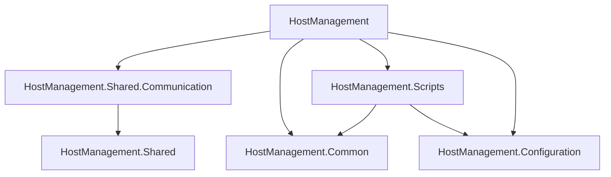

# HostManagement

Das Projekt **HostManagement (HM)** ist eine AOT kompilierte .NET-Anwendung für Debian. Es dient der Bereitstellung einer einheitlichen Schnittstelle zur Systemkonfiguration und ermöglicht die Kommunikation mit übergeordneten Anwendungen (z. B. **ViciOne Suite**) über Named Pipes.

## Hauptziele des Projektes

* Bereitstellung einer einheitlichen Schnittstelle zur Systemkonfiguration für Linux und Docker/Kubernetes.
* Implementierung permanenter, konfigurierbarer Health-Checks des Systems und der übergeordneten Anwendung.
* Durchführung permanenter, konfigurierbarer Monitoring-Aufgaben für relevante Systemeigenschaften wie CPU, RAM, HDD, Netzwerklast usw. mit optimierter Datenspeicherung für FlashCards.
* Backup, Update und Restore der übergeordneten Anwendung (**ViciOne Suite**) einschließlich Hintergrunddownloads von Updates aller Komponenten und Module. Hierbei geht es um alle Updates, die mit apt installiert werden. Nuget macht die **ViciOne Suite** selbst.
* Laden und Entladen von Apps, Modulen und Komponenten der übergeordneten Anwendung.
* Effiziente Kommunikation mit der übergeordneten Anwendung über Named Pipes. Das **HostManagement** ist der Server, die **ViciOne Suite** ist der Client.
* Auf Flash Systemen sollen alle Elemente die häufig schreiben im RAM oder einer RAM-Disk liegen.
* Minimalistisches Design und hohe Effizienz, um die Größe des Tools und der zugehörigen Bibliotheken zu minimieren.
* Bereitstellung als AOT-kompilierte Command-Line-Anwendung.
* Bereitstellung umfassender Validierungen für Benutzereingaben und Systemkonfigurationen, um Fehler zu minimieren und die Zuverlässigkeit zu gewährleisten.
* Unterstützung mehrerer Sprachen für die Validierungen der UI.
* Da das **HostManagement** erhöhte Rechte besitzt ist sicherzustellen, dass nur die zugehörige übergeordnete Anwendung oder ein Shellscript mit gleichen oder höheren Rechten Zugriff auf das **HostManagement** hat.

## Projektstruktur

Das Projekt ist in mehrere Hauptkomponenten unterteilt:



### HostManagement

Dies ist das Hauptprojekt des Tools und enthält die **Kernlogik** für die **Systemkonfiguration**.

Es umfasst die Definitionen der Befehle für die **Kommandozeile**, die Logik für die Kommunikation über **Named Pipes**, die **Health-Checks** sowie das **Monitoring**.

### HostManagement.Common

`HostManagement.Common` enthält **gemeinsame Logik** innerhalb des **HostManagement** (Helper, Utilities, Abstractions etc.).

### HostManagement.Configuration

`HostManagement.Configuration` enthält Anwendungs-Konfigurationen wie **Umgebungsvariablen** oder **anwendungsspezifische Pfade**.

### HostManagement.Scripts

Dieser Teil der Anwendung ist für die Ausführung der **Shell-Skripte** verantwortlich und kann angepasst werden, falls eine neue Unix-Plattform unterstützt werden soll.

`HostManagement.Scripts` ist die einzige **Schnittstelle** zum **Betriebssystem** und führt alle Lese- und Schreiboperationen der Systemkonfiguration durch. Es dient auch als Datenquelle für das **Monitoring** und die **Health-Checks**.

Wird ein **Shell-Skript** ausgeführt, gibt dieses eine Antwort ([`ScriptResponse`](docs/ScriptResponse.md)) zurück, welche angibt, ob die durchgeführten Aktionen erfolgreich waren und ob Warnungen oder Fehler aufgetreten sind.

### HostManagement.Shared

`HostManagement.Shared` enthält eine gemeinsame **Bibliothek** für alle **Validierungen** und das **Datenmodell** der **Systemkonfiguration**. Diese Bibliothek wird sowohl vom **HostManagement** als auch von der **ViciOne Suite** verwendet.

### HostManagement.Shared.Communication

`HostManagement.Shared.Communication` enthält eine gemeinsame **Bibliothek** für die **Kommunikation** über **Named Pipes**. Diese Bibliothek wird sowohl vom **HostManagement** als auch von der **ViciOne Suite** verwendet.

```text
HostManagement                           <-- HostManagement Solution
│
├── HostManagement                       <-- Hauptprojekt für das Host Management (HM)
│   │
│   ├── Communication                    <-- Hier werden alle Kommunikationskanäle definiert
│   │   ├── CommandLine                  <-- CLI-Implementierung (Kommunikation über Named Pipes)
│   │   │   ├── Commands                 <-- Commands der CLI
│   │   │   ├── Extensions               <-- Extensions für die CLI
│   │   │   ├── Helper                   <-- Helper für die CLI
│   │   ├── NamedPipes                   <-- Named Pipes Implementierung (zur Kommunikation mit der ViciOne Suite)
│   │   │   ├── Extensions               <-- Extensions für die Named Pipes
│   │   │   ├── RequestHandlers          <-- Request Handler für die Named Pipes (zum Laden/Anwenden von Settings etc.)
│   │   └── ...
│   │
│   ├── HealthChecks                     <-- Systemüberwachung durch das HostManagement
│   │   ├── CpuRam                       <-- Gruppe für Health Checks (Beispiel für CPU & RAM)
│   │   └── ...                          <-- Weitere Health-Checks
│   │
│   ├── Monitoring                       <-- Systemmonitoring durch das HostManagement
│   │   ├── CpuRam                       <-- Untergruppe für Monitoringziele (Beispiel für CPU & RAM)
│   │   └── ...                          <-- Weitere Monitoringziele
│   │
│   ├── Logger                           <-- Logging Klassen
│   │   └── ...
│   │
│   ├── SystemConfig                     <-- Klassen zur Modifikation der Konfiguration des Systems
│   │   ├── Network                      <-- Untergruppe für Netzwerk
│   │   └── ...                          <-- Weitere Klassen passend zu den Gruppen im
│   │                                        Systemeinstellungsdialog der ViciOne Suite
│   │
│   ├── Program.cs                       <-- Einstiegspunkt des Tools
│   ├── HostManagement.csproj            <-- Projektdatei für das Hauptprojekt
│   └── ...
│
│
├── HostManagement.Common                <-- Unterprojekt für Helper, Utilities, Abstractions etc.
│
│
├── HostManagement.Configuration         <-- Unterprojekt für Anwendungs-Konfigurationen (Umgebungsvariablen, anwendungsspezifische Pfade etc.)
│
│
├── HostManagement.Scripts               <-- Unterprojekt für die Scripts, die mit dem Basissystem kommunizieren
│   │
│   ├── Enums                            <-- Sammelordner für Enums
│   │   └── ...
│   │
│   ├── Extensions                       <-- Extensions (z. B. für string-Anpassungen bzgl. Unix-LineEndings)
│   │
│   ├── Resources                        <-- Alle deploybaren Ressourcen (Scripte etc.)
│   │   ├── Scripts                      <-- Shell-Skripte - alle Scripte zur Kommunikation mit dem Basissystem
│   │   │   ├── Network                  <-- Untergruppe für Netzwerkscripte
│   │   │   └── ...                      <-- Weitere Untergruppen passend zu den Gruppen im Systemeinstellungsdialog der ViciOne Suite
│   │   └── ...
│   │
│   ├── ScriptOptions                    <-- Alle Name der Optionen für die jeweiligen Scripte (z. B.: "--ip-address")
│   │
│   ├── Utilities                        <-- Unterordner für Hilfs- und Utility-Skripte
│   │   └── ...                          <-- Weitere Hilfsskripte
│   │
│   ├── ResourceManager.cs               <-- Verantwortlich für Deployment/Aufrufbarkeit der Scripte
│   ├── ScriptResponse.cs                <-- Die Script-Antwort inkl. ExitCode und Warnungen/Fehlern
│   ├── ScriptRunner.cs                  <-- Führt alle Scripte aus
│   └── ...
│
│
├── HostManagement.Shared                <-- Unterprojekt für die Komponenten, die im HostManagement und in der ViciOne Suite genutzt werden
│   │
│   ├── Contracts                        <-- Datenmodell der Systemkonfiguration
│   │
│   └── Validation/                      <-- Validierung der Systemkonfiguration
│       ├── Validators                   <-- Ordner für Validierungsklassen
│       └── ...
│
│
└── HostManagement.Shared.Communication  <-- Unterprojekt für Named Pipe Kommunikation zwischen HostManagement und ViciOne Suite
    │
    ├── Contracts                        <-- Datenmodell für die Kommunikation
    ├── Enum                             <-- Enumerationen
    └── Extensions                       <-- Sammelordner für Extensions / optional nach Thema in den andern Ordnern
```

## Deployment

### Installieren der Toolchain

Die Installation der Toolchain zur Erstellung und Ausführung des HostManagements wird hier beispielhaft anhand der Nutzung in einer VM mit VMware beschrieben. Hierfür sind zusätzliche Schritte im Vergleich zur nativen Ausführung notwendig (z. B.: Installation der VMware Tools). Die zusätzlichen Schritte werden mit (**_VM_**) gekennzeichnet.

1. **(_VM_)** **VMware Workstation** 17.5.2 oder neuer installieren
1. **Debian** 12 installieren
1. **Debian** einrichten
    1. `Automatic Suspend` in den Einstellungen **ausschalten**
    1. Benutzerkonto der `sudoers.d`-Datei hinzufügen, um sudo-Befehle ausführen zu können
        1. In den Ordner `etc` navigieren
        1. Über `Terminal` `su` für den Administrator/Root-Account ausführen
        1. Befehl `sudo visudo` ausführen (Datei `sudoers.d` wird geöffnet)
        1. Name des Benutzerkontos wie folgt hinzufügen: `Benutzerkonto ALL=(ALL:ALL) ALL`
        1. Datei speichern
    1. **(_VM_)** **VMware Tools** über Terminal installieren, falls nicht automatisch geschehen
        1. `sudo apt-get install open-vm-tools`
        1. `sudo apt-get install open-vm-tools-desktop`
    1. **(_VM_)** **SharedFolder** in VMware einrichten (z. B.: "Shared")
    1. **(_VM_)** Ordner in Debian **permanent mounten** (z. B.: "Shared" von Host nach "/home/USER/Shared" auf Gast)
        1. In den Ordner `etc` navigieren
        1. Über Terminal `sudo nano fstab` ausführen
        1. Datei ergänzen um `.host:/Shared  /home/USER/Shared  fuse.vmhgfs-fuse  defaults,allow_other,nofail  0  0`
        1. Neueinlesen der fstab über `sudo mount -a`
    1. **.NET SDK installieren** (siehe [InstallNetSdk])
    1. **Abhängigkeiten** für `dotnet publish` installieren
        1. `sudo apt-get install clang`
        1. `sudo apt-get install zlib1g-dev`
    1. **Netplan** als **Netzwerk-Manager** einrichten und mit **systemd-networkd** sowie **systemd-resolved** nutzen (Anleitung nach [DebianToNetplan])
        1. **Netplan** und **systemd-resolved** installieren: `sudo apt install netplan.io systemd-resolved -y`
        1. **Netzwerk-Dienste** aktivieren und **networking**-Dienst über unmask komplett deaktivieren

            ```bash
            sudo systemctl unmask systemd-networkd.service;
            sudo systemctl unmask systemd-resolved.service;
            sudo systemctl enable systemd-networkd.service;
            sudo systemctl mask networking;
            sudo systemctl enable systemd-resolved.service;
            ```

        1. Zu **Netplan** migrieren:
            1. `sudo ENABLE_TEST_COMMANDS=1 netplan migrate && sudo netplan try`
            1. Berechtigungen korrigieren: `sudo chmod 600 /etc/netplan/*`
                > **Hinweis:** Falls keine Einstellungen migriert wurden (da nicht vorhanden etc.), sollte eine Default-Config unter `etc/netplan/10-config.yaml` für alle Netzwerkschnittstellen angelegt werden.
                **Beispiel für eine Default-Config**

                ```yaml
                network:
                  version: 2
                  renderer: networkd
                  ethernets:
                    ens33:
                      dhcp4: true
                    ens35:
                      dhcp4: true
                ```

        1. System **neustarten**
        1. **Network Manager**, **ifupdown** und **resolvconf** deinstallieren:
            * `sudo apt purge network-manager ifupdown resolvconf -y`
            * `sudo rm -rf /etc/NetworkManager && sudo rm -rf /etc/network`
        1. Neuen Link auf `resolv.conf` erstellen: `sudo ln -sf /run/systemd/resolve/stub-resolv.conf /etc/resolv.conf`
    1. **Paketquellen** für **NexusPublic** und **NexusDev** einrichten (Name und Passwort entsprechend einsetzen)
        1. `dotnet nuget add source https://nexus.nsc-gmbh.de/repository/nuget-public/index.json -n NexusPublic -u MAX.MUSTERMANN -p PASSWORD --store-password-in-clear-text --protocol-version 3`
        1. `dotnet nuget add source https://nexus.nsc-gmbh.de/repository/nuget-dev/index.json -n NexusDev -u MAX.MUSTERMANN -p PASSWORD --store-password-in-clear-text --protocol-version 3`

### Veröffentlichen

* Für Linux x64

    ```bash
    dotnet publish -r linux-x64
    ```

* Für Linux ARM 64

    ```bash
    dotnet publish -r linux-arm64
    ```

**Hinweis:** AOT-Kompilierung ist für `dotnet publish` konfiguriert. `dotnet build` ignoriert die AOT-Einstellung.

## Installation

### Abhängigkeiten

* `netplan` (alle Netzwerkmanager außer `systemd-networkd` müssen deaktiviert sein)
* `wget`
* `systemd-networkd` enabled
* `systemd-resolved` enabled (DNS Namensauflösung inkl. Diensterkennung in lokalen Netzwerken über mDNS)

### Einrichtung

* Download der aktuellen Version aus [GitLab][GitlabHostManagementPackage] -> Pipelines -> Stage `Packaging`
* Installation des Debian-Paketes mit `sudo apt install ./<PackageName>`

## Benutzung

> **Hinweis:** Das `HostManagement` benötigt erweiterte Rechte, um Einstellungen am System vornehmen zu können (z. B.: Ändern der Netzwerkeinstellungen).

1. Ausführung des `HostManagement` im **daemon mode**, zum Beispiel als Linux-Service

    `hostmanagement --daemon`

1. Ausführung des `HostManagement` als **CLI**-Anwendung, welche mit dem zuvor über Named Pipes gestarteten Dienst kommuniziert

    `hostmanagement [command] [options]`

    **Beispiel "HTTP-Proxy":**

    ```bash
    hostmanagement network proxy http -e <true/false> -s <server> -p <port> -u <username> -pw <password>
    hostmanagement network proxy http --enabled <true/false> --server <server> --port <port> --username <username> --password <password>
    ```

### Umgebungsvariablen

Eine Auflistung der Umgebungsvariablen welche für das HostManagement definiert sind, befindet sich [hier](/docs/EnvironmentVariables.md).

### Log Level

Das HostManagement gibt standardmäßig Log-Meldungen ab Log-Level `Warning` aus. Das Log-Level kann über die Umgebungsvariable `LOGGING__LOGLEVEL__DEFAULT` angepasst werden. Mögliche Log-Level sind die Log-Level des Enums `Microsoft.Extensions.Logging.LogLevel`.

Beispiel **Service**:

```bash
LOGGING__LOGLEVEL__DEFAULT=Information sudo -E hostmanagement --daemon
```

Beispiel **Client**:

```bash
LOGGING__LOGLEVEL__DEFAULT=Information sudo -E hostmanagement network list-interfaces
```

## Vorgehen beim Erweitern des HostManagementes und der Definition weiterer Commandos

1. **Befehlsdefinition:** Neue Befehle werden im Ordner "CommandLine" des **HostManagement**-Projekts erstellt. Jeder Befehl wird als separate Klasse implementiert und kann zusätzliche Parameter oder Optionen akzeptieren, die von der Kommandozeile übergeben werden. Die Struktur der Befehl orientiert sich an Git. Es wird - für Kurzparameter und -- für ausführliche Parameter verwendet. Jeder Befehl muss eine Hilfe liefern. Die Hilfe ist wie bei Git in Ebenen gegliedert. Befehle sollen das komplette Setzen und Lesen von Eintellungsgruppen, sowie auch das Setzen von einzelnen Einstellungen unterstützen.

2. **Validierung:** Bei der Definition neuer Befehle ist es wichtig, die Validierung der Benutzereingaben zu berücksichtigen. Dies umfasst die Überprüfung auf gültige Parameter, Formatierung und mögliche Fehlerbehandlungsszenarien. Wenn Einstellungen einzeln gesetzt werden ist immer zu prüfen, ob die einzelne Einstellung zu den schon gesetzten Einstellungen passt. Dabei ist die Systemkonfiguration immer neu auszulesen, da eventuell andere Programme Änderungen vorgenommen haben könnten. Das Command-Line-Tool HostManagement ist nur in englisch verfügbar. Die ViciOneSuite UI ist mehrsprachig. das muss bei der Entwicklung der Validierungslogik berücksichtigt werden.

3. **Integration:** Alle Befehle können sowohl von der Kommandozeile, als auch von der übergeordneten Anwendung aus ausgeführt werden können. Die ViciOne Suite ruft dabei nie Befehle selbst auf, sondern übergibt eine neue Gesamtkonfiguration des Systems. Das Hostmenagement analysiert die neue Gesamtkonfiguration und ruft, wenn die Validierung erfolgreich war dasnn selbsttätig die erforderlichen Befehle auf. So wird eine optimale Abstraktion erreicht.
Es sollen nach Möglichkeit keine externen Bibliotheken verwendet werden und die Größe des Kommand-Line-Tools **HostManagement** sowie der shared **Validation** library sollen minimal sein. Das HostManagement wird AOT kompiliert.

4. **Tests:** Nach der Implementierung neuer Befehle sollten stets umfassende Unit-Tests erstellt werden, um sicherzustellen, dass sie korrekt funktionieren und die erwarteten Ergebnisse liefern. Die zugehörige Dokumentation wird als MarkDown erstellt und muss immer Up-to-Date sein.

## Sicherheit

### HostManagement

1. **Benutzer- und Gruppenberechtigungen**
    * Das HostManagement wird von einem dedizierten Systembenutzer ausgeführt, der nur die minimal notwendigen Rechte besitzt, um die Sicherheit zu maximieren.
    * Beispiel für die Erstellung eines Benutzers `hostmgmt` und einer gleichnamigen Gruppe:

      ```bash
      sudo adduser --system --no-create-home --group hostmgmt
      ```

2. **Beschränkung der Ausführbarkeit**
    * Die Berechtigungen des HostManagement-Executables werden so gesetzt, dass nur der Benutzer `hostmgmt` und seine Gruppe das Tool ausführen können, um unbefugten Zugriff zu verhindern.
    * Beispiel für das Setzen der Berechtigungen:

      ```bash
      sudo chown hostmgmt:hostmgmt /pfad/zum/host_management
      sudo chmod 750 /pfad/zum/host_management
      ```

      Die Berechtigung `750` ermöglicht es dem Benutzer `hostmgmt`, das Programm zu lesen, zu schreiben und auszuführen, während die Gruppe `hostmgmt` das Programm lesen und ausführen kann, aber nicht ändern darf.

3. **Verwendung von `sudo` für privilegierte Aktionen**
    * `sudo` wird so konfiguriert, dass spezifische Befehle des HostManagement-Tools ohne Passworteingabe von zuvor definierten autorisierten Benutzern ausgeführt werden können.
    * Beispiel für eine `sudoers`-Konfiguration, die das Ausführen bestimmter Befehle ohne Passwort erlaubt:

      ```bash
      hostmgmt ALL=(ALL) NOPASSWD: /pfad/zum/host_management
      ```

### Sicherheitseinstellungen für Named Pipes

1. **Named Pipe:**
   * Die Named Pipe wird mit spezifischen Zugriffsbeschränkungen erstellt, um sicherzustellen, dass nur autorisierte Benutzer und das HostManagement darauf zugreifen können.
   * Beispiel für die Erstellung und das Setzen der Zugriffsrechte:

      ```bash
      mkfifo /pfad/zur/named_pipe
      chown hostmgmt:appuser /pfad/zur/named_pipe
      chmod 660 /pfad/zur/named_pipe
      ```

      In diesem Fall ist `hostmgmt` der Besitzer und `appuser` die Gruppe. Beide haben Lese- und Schreibzugriff auf die Named Pipe, was sicherstellt, dass nur das HostManagement und die spezifizierte übergeordnete Anwendung darauf zugreifen können.

[DebianToNetplan]: https://pedroagrodrigues.com/posts/Debian_To_Netplan/
[GitlabHostManagementPackage]: https://gitlab.i40.ifm-datalink.net/acx/vo-suite/hostmanagement-deb-packaging
[InstallNetSdk]: https://learn.microsoft.com/en-us/dotnet/core/install/linux-debian#install-the-sdk
