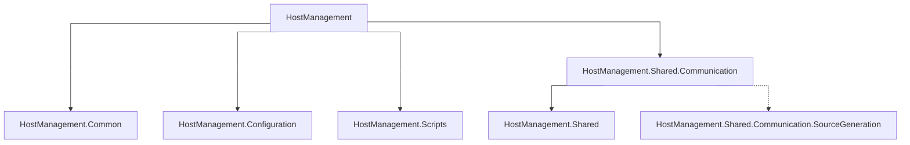

# HostManagement

The **HostManagement (HM)** project is an AOT-compiled .NET application for Debian. It provides a unified interface for system configuration and enables communication with higher-level applications (e.g. **ViciOne Suite**) via named pipes.

**Main Goals** of the project are:

* Provide a unified interface for system configuration for Linux and Docker/Kubernetes.
* Delivery as an AOT-compiled command-line application for efficiency.
* Efficient communication with the higher-level application via named pipes.
* Provide comprehensive validations for system configuration to minimize errors and ensure reliability.

A description of the conceptual ideas and design decisions can be found under: [Concept]

|                                                                                              |                                                                                         |                                                                                        |
| :------------------------------------------------------------------------------------------- | :-------------------------------------------------------------------------------------- | :------------------------------------------------------------------------------------- |
| **[Getting Started](#getting-started)** <br> Quick Start / Target Environments               | **[Usage](#usage)** <br> CLI / Service / Environment Variables / Logging                | **[Architecture](#architecture)** <br> Request Processing / System Configuration Flows |
| **[Project Structure](#project-structure)** <br> Main Components / Project Structure Details | **[Contributing](#contributing)** <br> Development / Publishing / Toolchain / AI Agents | **[License](#license)** <br> License Status                                            |

## Getting Started

### Quick Start

* Prerequisites
  * Debian 12 with `systemd`
  * Sudo privileges
  * Environment file for **minimum feature set** configured

    ```bash
    sudo install -d -m 0755 /etc/hostmanagement/conf.d
    printf "HOSTMANAGEMENT__TARGET_ENVIRONMENT='debian'\n" | sudo tee /etc/hostmanagement/conf.d/50-hostmanagement.conf > /dev/null
    ```

    > [!note]
    > The value `debian` enables the **minimum feature set**. For detailed instructions on other target environments (e.g. **EdgeS ViciOne**) see [Target Environments](#target-environments).

* Install **HostManagement daemon**
  * Download the latest `.deb` package from the [Releases page](https://gitlab.com/vicione-oss/vicione/os/hostmgmt/-/releases/permalink/latest):
  * Install the package:
    * For x64/amd64

      ```bash
      sudo apt install ./hostmanagement_<version>_amd64.deb
      ```

    * For arm64

      ```bash
      sudo apt install ./hostmanagement_<version>_arm64.deb
      ```

    > [!note]
    > If installation was successful the status can be checked with `systemctl status hostmanagement`

* Run **HostManagement CLI**, e.g.

    ```bash
    sudo hostmanagement service status -n ssh
    ```

### Target Environments

The following target environments are supported:

> [!note]
> Dependencies differ per environment. Dependencies like core, text/shell and system utilities that are present in every Linux distribution are not listed.

#### Debian (debian)

Currently the functionality is limited to managing systemd units only.

The dependencies are:

* `procps` (`pgrep`; licensed under GPL-2.0-or-later)

#### EdgeS ViciOne (edges-vicione)

Offers the complete functionality needed to be able to work with the ViciOne Suite.

The dependencies are:

* `netplan` (all network managers except `systemd-networkd` must be disabled; licensed under GPL-3.0)
* `procps` (`pgrep`; licensed under GPL-2.0-or-later)
* `fw_printenv` (internal tool without license)
* `systemd`
  * `systemd-networkd` enabled
  * `systemd-resolved` enabled (DNS name resolution incl. service discovery in local networks via mDNS)

## Usage

### HostManagement CLI

**HostManagement** is normally started as a Linux service after successful installation. The command line interface can be used to communicate with the previously started service via named pipes.

`sudo hostmanagement [command] [options]`

> [!important]
> Elevated privileges are required.

> [!note]
> To show help and usage information, use the options `-?, -h, --help`.

#### Configuration template commands

The CLI provides two helper commands for working with `SystemConfiguration` templates.

* Generate a JSON configuration template with sample data:

  `sudo hostmanagement --create-configuration-template`

  > [!note]
  > The output can be redirected.

* Validate a configuration template file:

  `sudo hostmanagement --validate-configuration-template --path configuration-template.json`

  > [!note]
  > This command validates a modified configuration template. It is not intended for normal operation.
  >
  > The validation result is written to the console output.

  > [!important]
  > The configuration is not fully validated because the internal `SystemConfigurationValidatorInternal` is not used here. The configurable services are not accessible in this context.

#### Example "service status" command

The command

```bash
sudo hostmanagement service status -n ssh
```

will print the current active state of the service, e.g. `active`, `inactive` etc.

### HostManagement Service

**HostManagement** is normally started as a Linux service after successful installation. For a detailed description of the startup behaviour see [docs/HostManagementServiceStartup.md].

If it shall be started manually via terminal, follow the steps below.

> [!important]
> Elevated privileges are required.

> [!note]
> Only **one** service instance can be active at a time.

1. Make sure to stop a running **HostManagement** service

    ```bash
    sudo systemctl stop hostmanagement.service
    ```

1. Start the daemon mode and specify all required environment variables (for the wanted target environment)

    ```bash
    sudo -E env HOSTMANAGEMENT__TARGET_ENVIRONMENT='debian' hostmanagement --daemon
    ```

    > [!note]
    > For a list of supported environment variables refer to [Environment Variables](#environment-variables) below.

### Environment Variables

A list of environment variables defined for **HostManagement** can be found in [docs/EnvironmentVariables.md].

### Logging

By default, **HostManagement** logs messages from log level `Warning`. The log level can be adjusted via the environment variable `LOGGING__LOGLEVEL__DEFAULT`.

> [!note]
> Possible log levels are `Trace`, `Debug`, `Information`, `Warning`, `Error`, `Critical`, `None`.

Logs can be viewed using the `journalctl` command:

```bash
sudo journalctl -u hostmanagement --output=short-precise
```

## Architecture

**HM** processes named-pipe requests through services, configuration adapters and scripts that interact with the underlying operating system.

The request-processing architecture, including script execution and system configuration flows, is documented in [docs/Architecture.md].

## Project Structure

The project is divided into several main components:



<details>
  <summary markdown="span">

  `Project Structure Details`

  </summary>

  <pre>
  HostManagement                           <-- HostManagement Solution
  ├── HostManagement                       <-- Main project for Host Management (HM)
  │   ├── Communication                    <-- All communication channels are defined here
  │   │   ├── CommandLine                  <-- CLI implementation (communication via named pipes)
  │   │   │   ├── Commands                 <-- CLI commands
  │   │   │   ├── Output                   <-- Output formatting for the CLI
  │   │   │   └── Validators               <-- Validators for the CLI
  │   │   └── NamedPipes                   <-- Named pipes implementation (for communication with the ViciOne Suite)
  │   │       ├── Client                   <-- Client implementation
  │   │       └── RequestHandlers          <-- Request handlers for the named pipes (for loading/applying settings etc.)
  │   ├── Services                         <-- Services for DHCP, network status information, NTP, physical addresses, system and systemd units
  │   ├── SystemConfig                     <-- Classes to modify the system configuration
  │   │   ├── Contracts                    <-- Internally used contracts (DTOs) for reading and applying of a configuration
  │   │   ├── Migrations                   <-- Contract migration logic and archived older contract versions
  │   │   ├── Network                      <-- Network configuration adapter
  │   │   └── Service                      <-- Service configuration adapter
  │   ├── ViciOneSuite                     <-- ViciOne Suite-specific functions (version, installation)
  │   │
  │   └── Program.cs                       <-- Entry point of the tool
  │
  │
  ├── HostManagement.Common                <-- Subproject for helpers, utilities, abstractions, etc.
  │   ├── Utilities                        <-- Utility classes
  │   └── Wrappers                         <-- Wrappers for system functions
  │
  │
  ├── HostManagement.Configuration         <-- Subproject for application configurations (environment variables, application-specific paths, etc.)
  │
  │
  ├── HostManagement.Scripts               <-- Subproject for the scripts that communicate with the base system
  │   ├── Enums                            <-- Collection folder for enums
  │   ├── Extensions                       <-- Extensions (e.g. for string adjustments regarding Unix line endings)
  │   ├── Resources                        <-- All deployable resources (scripts, etc.)
  │   │   └── Scripts                      <-- Shell scripts - all scripts for communicating with the base system
  │   │       ├── shared
  │   │       │   ├── Common               <-- Scripts for general use
  │   │       │   ├── System               <-- Scripts for system operations
  │   │       │   └── SystemdUnit          <-- Scripts to control systemd units
  │   │       └── targets
  │   │           ├── debian
  │   │           │   ├── Common           <-- Symlink to scripts from shared
  │   │           │   ├── System           <-- Debian-specific system scripts
  │   │           │   └── SystemdUnit      <-- Symlink to scripts from shared
  │   │           └── edges-vicione
  │   │               ├── Common           <-- Symlink to scripts from shared
  │   │               ├── Network          <-- Subgroup for network scripts
  │   │               ├── System           <-- EdgeS ViciOne-specific system scripts
  │   │               ├── SystemdUnit      <-- Symlink to scripts from shared
  │   │               └── ViciOne          <-- ViciOne-specific scripts
  │   │
  │   ├── ResourceManager.cs               <-- Responsible for deployment/invokability of the scripts
  │   ├── ScriptOptionNames.cs             <-- All option names for the respective scripts (e.g. "--ip-address")
  │   ├── ScriptResponse.cs                <-- The script response incl. exit code and warnings/errors
  │   └── ScriptRunner.cs                  <-- Executes all scripts
  │
  │
  ├── HostManagement.Shared                <-- Subproject for the components used in HostManagement and in the ViciOne Suite
  │   ├── Contracts                        <-- Public data model of the system configuration
  │   ├── Serialization                    <-- Serialization logic
  │   └── Validation                       <-- Validation of the system configuration
  │       └── Validators                   <-- Folder for validation classes
  │
  │
  ├── HostManagement.Shared.Communication  <-- Subproject for named pipe communication between HostManagement and ViciOne Suite
  │   ├── Contracts                        <-- Data model for communication
  │   └── Serialization                    <-- Serialization logic
  │
  │
  └── HostManagement.Shared.Communication.SourceGeneration  <-- Source generator for communication
  </pre>

</details>

### HostManagement

This is the main project of the tool and contains the **core logic** for **system configuration**.

It includes the definitions of the commands for the **command line** and the logic for communication via **named pipes**.

#### System configuration contract migrations

Persisted `SystemConfiguration` JSON files contain a `Version` property.\
When HostManagement loads a configuration, older supported contract versions are migrated to the current internal contract version before deserialization.

Details about the migration design, versioning rules and how to add new migrations are documented in [docs/SystemConfigurationMigrations.md].

### HostManagement.Common

`HostManagement.Common` contains **shared logic** within **HostManagement** (helpers, utilities, abstractions etc.).

### HostManagement.Configuration

`HostManagement.Configuration` contains application configurations such as **environment variables** or **application-specific paths**.

### HostManagement.Scripts

This part of the application is responsible for executing the **shell scripts** and can be adapted if a new Unix platform is to be supported.

`HostManagement.Scripts` is the only **interface** to the **operating system** and performs all read and write operations of the system configuration. It also serves as a data source for **monitoring** and **health checks**.

When a **shell script** is executed, it returns a response indicating whether the actions performed were successful and whether warnings or errors occurred (see [docs/ScriptResponse.md]).

### HostManagement.Shared

`HostManagement.Shared` contains a shared **library** for all **validations** (e.g. [DNS Validation]) and the **data model** of the **system configuration**. This library is used by both **HostManagement** and the **ViciOne Suite**.

### HostManagement.Shared.Communication

`HostManagement.Shared.Communication` contains a shared **library** for **communication** via **named pipes**. This library is used by both **HostManagement** and the **ViciOne Suite**.

## Contributing

### Development

* Target Framework: .NET 10 (AOT), .NET Standard 2.0 (for source generation)
* Supported Runtime: Linux (Debian 12) x64/arm64
* Recommended IDEs: [Visual Studio 2026] or [Visual Studio Code]

#### Windows

Add the following NuGet sources:

* `dotnet nuget add source https://jfrog.i40.ifm-datalink.net/artifactory/api/nuget/v3/vicione-nuget.org-proxy/index.json -n JFrogNuGetProxy -u <user> -p <token> --protocol-version 3`
* `dotnet nuget add source https://jfrog.i40.ifm-datalink.net/artifactory/api/nuget/v3/vicione-nuget/index.json -n JFrogViciOne -u <user> -p <token> --protocol-version 3`

To be able to use **symbolic links**, which are used for the **script resources**, the following steps are required:

1. Activate `Developer Mode` of Windows via `Settings` > `System` > `Advanced`

    > [!note]
    > Prior to **Windows 11 25H2**, these settings appear in `Settings` > `System` > `For developers`.
    >
    > Enabling Developer mode requires administrator access.

1. Add `symlinks = true` to `.gitconfig`

    ```text
    [core]
      symlinks = true
    ```

#### Linux

Add the following NuGet sources:

* `dotnet nuget add source https://jfrog.i40.ifm-datalink.net/artifactory/api/nuget/v3/vicione-nuget.org-proxy/index.json -n JFrogNuGetProxy -u <user> -p <token> --protocol-version 3 --store-password-in-clear-text`
* `dotnet nuget add source https://jfrog.i40.ifm-datalink.net/artifactory/api/nuget/v3/vicione-nuget/index.json -n JFrogViciOne -u <user> -p <token> --protocol-version 3 --store-password-in-clear-text`

To be able to build and publish, the following steps are required:

1. Install [**.NET SDK**][InstallNetSdk]
1. For the `dotnet publish` command, install `clang` and `zlib1g-dev`
    1. `sudo apt-get install clang`
    1. `sudo apt-get install zlib1g-dev`

### Publishing

* For Linux x64

  ```bash
  dotnet publish -r linux-x64
  ```

* For Linux ARM 64

  ```bash
  dotnet publish -r linux-arm64
  ```

> [!note]
> AOT compilation is configured for `dotnet publish`, `dotnet build` ignores the AOT setting.

### Install the Toolchain

Instructions for installing the toolchain, e.g. in VMware, can be found in [/docs/InstallToolchain.md](/docs/InstallToolchain.md).

### Local Tooling with mise

The repository uses [mise](https://mise.jdx.dev/) to pin needed tools (e.g. .NET SDK) and to provide helper tasks.

* Install mise itself, see [mise Getting Started](https://mise.jdx.dev/getting-started.html)
* Install tools pre-defined in [mise.toml](mise.toml):

  ```bash
  mise install
  ```

* Generate CLI help documentation:

  ```bash
  mise run extract-help
  ```

  Generated output file path is: `local/cli_help/cli_help_export.md` (configured in `mise.toml`).

### AI Agent Instructions

The project uses provider-independent `AGENTS.md` files for AI coding agent instructions:

* Repository-wide instructions: [`AGENTS.md`]
* Production code instructions: [`src/AGENTS.md`]
* Unit testing instructions: [`tests/AGENTS.md`]

## License

This project is licensed under the MIT License.
The full license text is available in [`LICENSE.txt`](./LICENSE.txt).

[`AGENTS.md`]: AGENTS.md
[Concept]: docs/Concept.md
[DNS Validation]: docs/DNSValidation.md
[docs/Architecture.md]: docs/Architecture.md
[docs/EnvironmentVariables.md]: docs/EnvironmentVariables.md
[docs/HostManagementServiceStartup.md]: docs/HostManagementServiceStartup.md
[docs/ScriptResponse.md]: docs/ScriptResponse.md
[docs/SystemConfigurationMigrations.md]: docs/SystemConfigurationMigrations.md
[InstallNetSdk]: https://learn.microsoft.com/en-us/dotnet/core/install/linux-debian#install-the-sdk
[`tests/AGENTS.md`]: tests/AGENTS.md
[`src/AGENTS.md`]: src/AGENTS.md
[Visual Studio 2026]: https://visualstudio.microsoft.com/vs/
[Visual Studio Code]: https://code.visualstudio.com/Download
