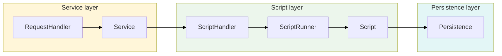
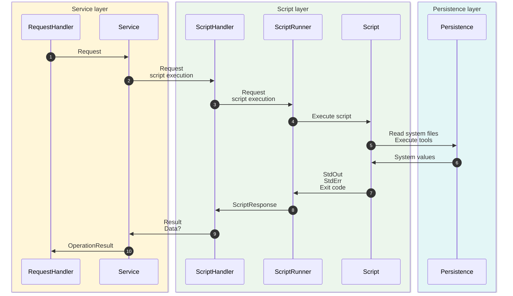
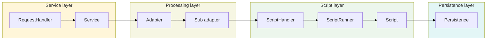
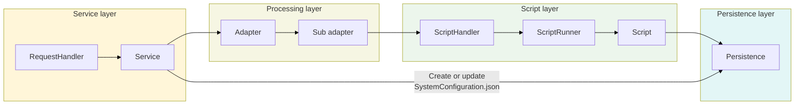

# Architecture

This document describes how named-pipe requests are processed within **HostManagement**, including the service layer, processing logic, script execution and system configuration persistence.

## Pipe Request Processing

### Simple Request

A simple request, e.g. getting network status information, involves the corresponding service, script execution and the persistence layer.

The general flow is shown below. Arrows indicate the invocation direction. Results are returned to the respective caller in the opposite direction.

- `RequestHandler` receives a named-pipe request, delegates it to a service and returns a serialized `OperationResult`.
- `Service` executes logic by calling scripts via `ScriptHandler` and returns `OperationResult`.
- `ScriptHandler` requests script execution from `ScriptRunner` and returns `Result` and `Data?`.
- `ScriptRunner` executes script with argument(s) and returns `ScriptResponse`.
- `Script` reads system files or executes tools and returns `StdOut`, `StdErr` and `Exit code`.

  

  `Detailed Flowchart`

  

### Complex Request (Get/Set Configuration)

For the complex pipe request to **get/set** the **system configuration**, an additional layer is involved between the corresponding `Service` and the `ScriptHandler`.\
This layer is based on `ConfigurationAdapter` and can call multiple **sub adapters** for specific logic, e.g. DNS, Proxy settings.

#### Get system configuration

> [!note]
> If the system configuration is retrieved, it is cached (default: 30 seconds). If it is requested within this time again, only the service layer gets involved and returns the cached configuration.

#### Set system configuration

> [!note]
> Every time the system configuration is changed, a still cached configuration is invalidated.

##### Configuration update semantics

`SetSystemConfiguration` validates the submitted contract version, then merges the submitted JSON properties with the current server configuration before validation and application.\
Omitted properties keep their current values, including properties inside nested objects. Explicitly submitted scalar values replace their current values.

The submitted `Version` is the contract version of the shared system configuration. It is required and must equal the server's current contract version.\
Missing, non-integer, older and newer versions are rejected with an error before any merge. A rejected request does not apply or persist configuration and does not publish a configuration-changed event.

**Collections follow these rules:**

| Collection                                                    | When explicitly submitted                                                                                                                                             |
| ------------------------------------------------------------- | --------------------------------------------------------------------------------------------------------------------------------------------------------------------- |
| `NetworkInterfaces`                                           | Merge entries by `CommonInformation.Name`. Preserve current interfaces that are omitted, and **ignore proposed interfaces not present in the current configuration**. |
| `Services`                                                    | Merge entries by `Name`. Preserve omitted services and **allow new services**.                                                                                        |
| `NetworkInterfaces[*].IPv4.IPv4Details`                       | Replace the entire list, without merging individual entries.                                                                                                          |
| `NetworkDNSSettings.StaticHosts.Hosts`                        | Replace the entire list, without merging individual entries.                                                                                                          |
| Value lists (for example, NTP servers and DNS search domains) | Replace the entire list.                                                                                                                                              |

An omitted collection is preserved. Submitting `[]` clears IPv4 details, static hosts, and value lists, but does not remove existing network interfaces or services.\
Existing interface and service properties not submitted for a matching entry remain unchanged.

**Every supported collection path has an explicit merge strategy.** When adding a new collection property to the shared contract, its update behavior must also be defined in `SharedSystemConfigurationMerger`, otherwise submitting that collection is rejected, even if it is empty.\

###### Replacement lists

`IPv4Details` and `NetworkDNSSettings.StaticHosts.Hosts` are replaced entirely when submitted.\
Individual entries are not merged with existing entries. Properties that a client omits from a submitted entry are therefore not preserved from the existing entry.\
Deserialization uses a default or rejects the entry, depending on the contract.

Consequently, if a future contract adds a property to one of these entry types, an older client that submits the list, omits that property and its existing value is lost.\
Such additions require a new contract version unless explicit preservation semantics are introduced. Omitting the entire collection continues to preserve it, and submitting `[]` clears it.

###### Contract evolution

Unknown properties in configuration **responses** are ignored by forward-compatible clients.\
Unknown properties in submitted configuration **updates** are rejected. Known values and required fields continue to be validated.

The **contract version changes** according to these **rules**:

- **Compatible additions** may **keep the contract version**.\
  This applies when older clients can still read responses and update the settings they know.
- Changes that violate this guarantee require a new contract version.
- Adding configurable properties to entries of **replacement lists can still break** configuration round trips (see [Replacement lists](#replacement-lists)).
- **Persisted-configuration migrations** and **client-request compatibility** are separate concerns.

This minimal API has no generic reset operation or concurrency protection.
