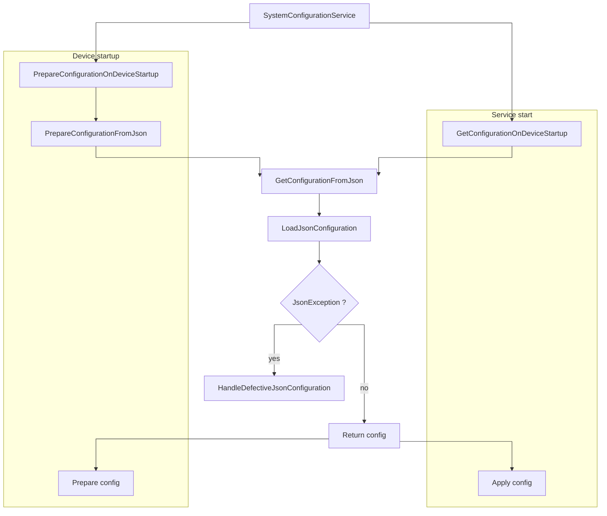

# HostManagement Service Startup

The startup behaviour of **HostManagement (HM)** depends on the `mode` it is called. There are two modes intended for customer use, `service` and `cli` mode.\
The behaviour of `service` mode is described below. For the `cli` mode refer to [README > Usage > HostManagement CLI].

Starting point of the `service` mode is the `ServiceRunner` class. It defines two `sub modes`:

* Device startup (`PrepareConfiguration`)
* Service start (`StartService`)

The **device startup** steps are executed on every device start, if it is configured e.g. in a `*.service` file.\
This is for example the case in the `EdgeS` Linux image.

The **service start** steps are executed after the **device startup** has finished or when the service is restarted. After the steps below are finished, the named pipe communication gets initialized.

> [!note]
> During **device startup** a `set-config.flag` file is created.\
> **Only** if this is present, the following **service start** flow is executed, otherwise `SystemConfigurationService` is not called.

The following chart illustrates both flows from a code perspective, starting from the called `SystemConfigurationService`.

## Startup configuration rules

The following rules are used to select the JSON configuration during **device startup**:

The following rules are used to select and apply the JSON configuration during startup:

1. `SystemConfiguration.json` has priority over `DefaultSystemConfiguration.json`.
1. If `SystemConfiguration.json` exists, `DefaultSystemConfiguration.json` is ignored.
1. If no `SystemConfiguration.json` exists, `DefaultSystemConfiguration.json` is used as fallback.
1. If `SystemConfiguration.json.defective` exists, `DefaultSystemConfiguration.json` is not used, even if it exists. This prevents overwriting a previously applied system configuration with defaults.
1. During **device startup**, the selected JSON configuration is loaded and prepared only. The configuration is not applied yet.
1. `set-config.flag` is created only when **device startup** successfully prepares a valid JSON configuration.
1. During **service start**, JSON configuration is applied only when `set-config.flag` exists.
1. During **service start**, `set-config.flag` is deleted before loading and applying the JSON configuration.
1. If `set-config.flag` does not exist, `SystemConfigurationService` is not called for JSON startup configuration and named pipe communication starts normally.
1. Applying the JSON configuration during **service start** calls `SetConfiguration(..., shouldPersistConfiguration: false)`, so the configuration is prepared and applied but not persisted again.

## Invalid JSON behaviour

If `SystemConfiguration.json` or `DefaultSystemConfiguration.json` exist but cannot be loaded because it is invalid JSON or cannot be deserialized[^1]:

1. Loading the JSON configuration fails.
1. `SystemConfigurationService` logs that getting the system configuration from JSON failed.
1. The defective file is renamed to `*.json.defective`.
   * `SystemConfiguration.json` becomes `SystemConfiguration.json.defective`.
   * `DefaultSystemConfiguration.json` becomes `DefaultSystemConfiguration.json.defective`.
1. `SystemConfigurationService` logs that the configuration was marked defective.
1. The prepare step logs failure.
1. `set-config.flag` is not created.
1. The following **service start** does not apply JSON startup configuration.

There is no fallback from an invalid `SystemConfiguration.json` to `DefaultSystemConfiguration.json` in the same startup flow.

[README > Usage > HostManagement CLI]: ../README.md#hostmanagement-cli

[^1]: This only applies to malformed JSON, e.g. with formatting issues, syntax errors etc. It does not apply to other reasons, such as migration problems or unsupported versions.
