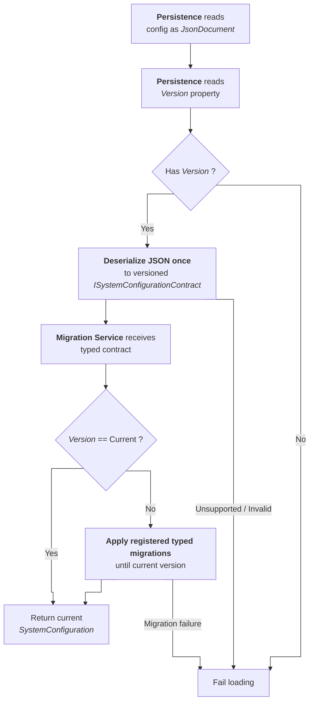

# System Configuration Migrations

**HostManagement (HM)** persists **internal system configuration** data as JSON. The JSON contains a required `Version` property that identifies the system configuration contract version.

```json
{
  "Version": 1,
  ...
}
```

When a configuration is loaded, **HM** **migrates supported** older contract **versions** to the current internal contract version. This is done before the configuration is used by the application.

## Runtime Flow

Configuration loading uses the following flow:

1. `SystemConfigurationPersistence` reads persisted system config as a `JsonDocument`
1. `SystemConfigurationPersistence` reads the `Version` property
1. `SystemConfigurationPersistence` uses the registered contract deserializer for that version
1. `SystemConfigurationMigrationService` receives the typed contract
    1. If `Version` is current -> return the current `SystemConfiguration` contract
    1. If `Version` is older -> apply registered typed migrations until the current version is reached

> [!note]
> Unsupported versions, missing `Version` properties and invalid migration results fail during loading.



## Main Components

### `ISystemConfigurationContract`

Implemented by all system configuration contract versions that participate in migrations.

Each contract exposes a `Version` property.

### `ISystemConfigurationMigration`

Represents **one migration step** from one **source** contract version to one **target** contract version.

A migration receives an `ISystemConfigurationContract` and returns an `ISystemConfigurationContract`.
The generic base class validates the concrete source type and the source/target versions.

### `ISystemConfigurationContractDeserializer`

Represents deserialization for **one persisted JSON contract version**.

A deserializer receives the JSON root element and returns the matching typed `ISystemConfigurationContract`.
It uses source-generated `JsonTypeInfo<T>` and validates that the deserialized contract `Version` matches the deserializer version.

### `SystemConfigurationContractDeserializer<TConfiguration>`

This is the **typed base class** for versioned deserializers. It bridges the JSON loading boundary and the typed migration pipeline as follows:

1. **Deserialize source JSON** to `TConfiguration`
1. **Validate** deserialized `Version`
1. Return the typed `ISystemConfigurationContract`

Concrete deserializers should derive from this class.

### `SystemConfigurationContractDeserializerRegistry`

The registry stores **registered deserializers** by `Version`. It validates that:

* Versions are valid
* Deserializers **do not target newer versions** than the current
* Only **one deserializer** is registered **per** version

### `SystemConfigurationMigration<TSourceConfiguration, TTargetConfiguration>`

This is the **typed base class** for migrations. It bridges the untyped migration service and typed migration logic as follows:

1. **Validate** source contract type
1. **Validate** source `Version`
1. **Execute** typed **migration**
1. **Validate** target `Version`
1. Return the typed target contract

Concrete migrations should usually derive from this class.

### `SystemConfigurationMigrationRegistry`

The registry stores **registered migrations** by `SourceVersion`. It validates that:

* Source **versions are valid**
* Migrations **move forward**
* Migrations **do not target newer versions** than the current
* Only **one migration** is registered **per source** version
* Intermediate **migration chains** are **complete**

### `SystemConfigurationMigrationService`

Orchestrates migration from the loaded source version to the current contract version.

It only works with typed `ISystemConfigurationContract` instances and has no JSON parsing or `JsonDocument` ownership responsibilities.

## Current Version Handling

The **current version** is represented by the current internal contracts in `src/HostManagement/SystemConfig/Contracts`.

Because this version is **not frozen yet**, the concrete migration targets the current contract types directly.\
When a newer current contract version is introduced, the **previous version must be frozen** by copying the version contracts to: `src/HostManagement/SystemConfig/Migrations/Contracts/Vx`.

After that, the concrete migration must target the frozen `Vx` contracts instead of the new current contracts.

## Adding a New Contract Version

When introducing a new system configuration contract version:

1. **Freeze previous** current contract **version** under `SystemConfig/Migrations/Contracts/Vx`
1. **Increase** `SystemConfiguration.CurrentVersion`
1. **Update current contracts** in `SystemConfig/Contracts`
1. **Add new migration** class, e.g.: `V2ToV3SystemConfigurationMigration`
1. **Register new migration** in `SystemConfig/SystemConfigurationPersistence`
1. **Add or update** source-generated JSON serializer context for the archived contract version
1. **Add and register** a contract deserializer in `SystemConfig/SystemConfigurationPersistence`
1. **Add** focused **unit tests** for the new migration
1. **Only update persistence integration tests** if the externally visible loading behavior changes

## Migration Implementation Rules

Concrete migrations must:

* **Explicitly set** the target contract `Version` to `TargetVersion`,
* **Only copy properties** that still exist in the target contract
* Intentionally **ignore removed properties** (maybe add comments)
* **Provide deterministic fallback behavior** for unsupported enum values

Concrete deserializers must:

* **Use source-generated** `JsonTypeInfo<T>` for the represented contract version
* **Use AOT-compatible** converters only, e.g. generic `JsonStringEnumConverter<TEnum>` instead of non-generic `JsonStringEnumConverter`
* **Validate** that the deserialized contract `Version` matches the represented version

**Example:**

```csharp
internal sealed class V2SystemConfigurationContractDeserializer
    : SystemConfigurationContractDeserializer<V2Contracts.SystemConfiguration>
{
    public override int Version => 2;

    protected override JsonTypeInfo<V2Contracts.SystemConfiguration> ConfigurationTypeInfo
        => V2Contracts.V2SystemConfigurationJsonSerializerContext.Default.SystemConfiguration;
}

internal sealed class V2ToV3SystemConfigurationMigration
    : SystemConfigurationMigration<V2Contracts.SystemConfiguration, CurrentContracts.SystemConfiguration>
{
    public override int SourceVersion => 2;
    public override int TargetVersion => 3;

    protected override CurrentContracts.SystemConfiguration Migrate(V2Contracts.SystemConfiguration source)
        => new()
        {
            Version = TargetVersion,
            ...
        };
}
```
